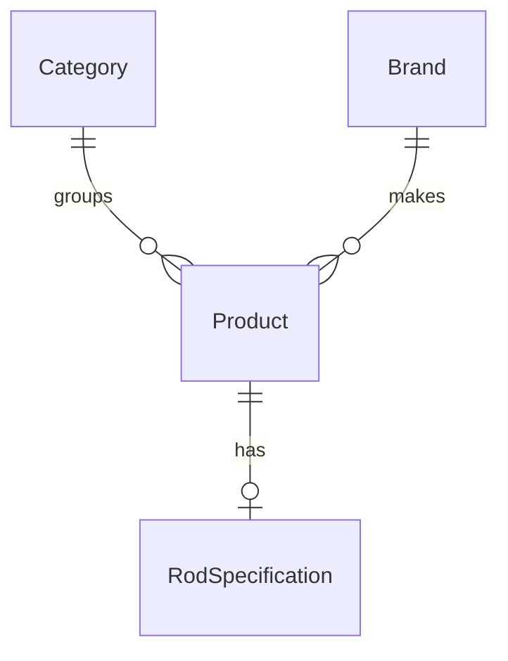

# Lokalna baza FishingShop

Docker Compose uruchamia SQL Server 2022 Developer. Skopiuj `.env.example` do `.env` i wpisz własne silne hasło pod `FISHINGSHOP_SQL_PASSWORD`. Plik `.env` jest ignorowany przez Git.

W katalogu projektu uruchom kontener i poczekaj na komunikat `SQL Server is now ready for client connections`. Naciśnij `Ctrl+C`, aby zakończyć podgląd logów.

```console
docker compose up -d sql
docker compose logs -f sql
```

Polecenie dla `sqlcmd` w wersji ODBC poprosi o hasło, utworzy bazę `FishingShop`, jeśli jeszcze jej nie ma, i wypisze nazwę bazy. Możesz je wykonać ponownie.

```console
sqlcmd -S tcp:127.0.0.1,14334 -U sa -N -C -b -i sql/create-database.sql
```

Możesz też użyć SSMS. Wybierz serwer `127.0.0.1,14334`, uwierzytelnianie SQL Server i login `sa`. Dla tego lokalnego kontenera zaznacz **Trust server certificate**. Otwórz `sql/create-database.sql` i uruchom skrypt. Po utworzeniu bazy możesz sprawdzić połączenie poleceniem `SELECT DB_NAME();` w kontekście `FishingShop`.

Port jest dostępny lokalnie, a wolumen `fishingshop_sql-data` przechowuje pliki SQL Servera. `docker compose stop sql` zatrzymuje kontener z zachowaniem danych. Hasło konta `sa` jest zapisywane podczas inicjalizacji. Późniejsza zmiana wpisu w `.env` wymaga także zmiany hasła w SQL Serverze.

## Plan relacji



| Tabela | Dane i klucze |
| --- | --- |
| `Category` | `Id`, `Name`. Jedna kategoria grupuje wiele produktów. |
| `Brand` | `Id`, `Name`. Jedna marka ma wiele produktów. |
| `Product` | `Id`, `Name`, `Description`, `Price` jako `decimal(18,2)`. `CategoryId` i `BrandId` to klucze obce. |
| `RodSpecification` | `ProductId` to klucz główny i obcy do `Product`. Parametry to `LengthCm`, `CastWeightMinG`, `CastWeightMaxG` oraz typ `Spinning` lub `Casting`. |

Długość zapisujemy w centymetrach, a oba ciężary w gramach. Dolna granica musi być dodatnia i nie może przekraczać górnej. Filtr dokładny `7-21 g` sprawdza obie granice. Filtr dla przynęty `14 g` sprawdza, czy `14` mieści się w przedziale wędki. Te warunki można łączyć z długością, marką i typem.

Tabele powstaną w kolejnej migracji EF Core. Aplikacja wyświetla obecnie katalog z listy w C#.
